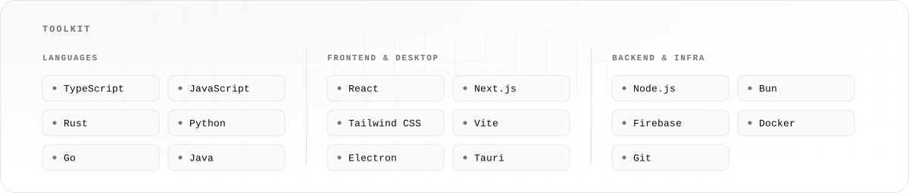

  <picture>
    <source media="(prefers-color-scheme: dark)" srcset="assets/header.svg" />
    
  </picture>

   
   

  <a href="https://www.instagram.com/henrique.lenz_/"><picture>
    <source media="(prefers-color-scheme: dark)" srcset="assets/social-instagram.svg" />
    
  </picture></a>
  &nbsp;
  <a href="https://x.com/"><picture>
    <source media="(prefers-color-scheme: dark)" srcset="assets/social-x.svg" />
    
  </picture></a>
  &nbsp;
  <a href="https://open.spotify.com/user/fs0ibi8t3pn9vqc2zhh9zkkrl"><picture>
    <source media="(prefers-color-scheme: dark)" srcset="assets/social-spotify.svg" />
    
  </picture></a>

 

### About

I build software products from the first idea to a working release. AI is my primary implementation tool — I own the **problem definition**, **specification**, **architecture**, **decisions**, and **testing**, and use AI to move from spec to shipped code faster.

Most of my projects start from a problem I run into myself and grow into complete, everyday tools: AI workspaces, study and health trackers, desktop utilities, and automation.

 

### Selected work

  <a href="https://github.com/riique/Haumea"><picture>
    <source media="(prefers-color-scheme: dark)" srcset="assets/project-haumea.svg" />
    
  </picture></a>
  <a href="https://github.com/riique/TelegramCloner"><picture>
    <source media="(prefers-color-scheme: dark)" srcset="assets/project-telegramcloner.svg" />
    
  </picture></a>
  <a href="https://github.com/riique/Sonora"><picture>
    <source media="(prefers-color-scheme: dark)" srcset="assets/project-sonora.svg" />
    
  </picture></a>
  <a href="https://github.com/riique/HaumeaStudies"><picture>
    <source media="(prefers-color-scheme: dark)" srcset="assets/project-haumeastudies.svg" />
    
  </picture></a>
  <a href="https://github.com/riique/AddictionLog"><picture>
    <source media="(prefers-color-scheme: dark)" srcset="assets/project-addictionlog.svg" />
    
  </picture></a>
  <a href="https://github.com/riique/Haumea-Physique"><picture>
    <source media="(prefers-color-scheme: dark)" srcset="assets/project-haumea-physique.svg" />
    
  </picture></a>

 

### Utilities

| Project | Description |
| :--- | :--- |
| [**MyScreen**](https://github.com/riique/MyScreen) | Real-time screen, camera, and audio streaming built with Next.js 15, LiveKit SFU, and Caddy. |
| [**AI Exporters**](https://github.com/riique/AI_Exporters) | Exports Claude, Grok, and ChatGPT conversations to JSON or Markdown. |
| [**riique-prompts**](https://github.com/riique/riique-prompts) | Curated prompts for terminal-capable AI agents. |
| [**MutualCheck**](https://github.com/riique/MutualCheck) | Compares Following and Followers on X without handing your account to a third-party service. |
| [**InstagramReelsSpeed**](https://github.com/riique/InstagramReelsSpeed) | Userscript that adds playback speed controls to Instagram Reels. |
| [**HaumeaMC**](https://github.com/riique/HaumeaMC) | Minecraft KitPvP and lobby plugin. Related projects: [LastDeath](https://github.com/riique/LastDeath), [PingCheck](https://github.com/riique/PingCheck), [NoAracnophobia](https://github.com/riique/NoAracnophobia). |
| [**AprendizadoAntigo**](https://github.com/riique/AprendizadoAntigo) | Archive of my early programming exercises. |

 

### Approach

  <picture>
    <source media="(prefers-color-scheme: dark)" srcset="assets/process.svg" />
    
  </picture>

 

### Toolkit

  <picture>
    <source media="(prefers-color-scheme: dark)" srcset="assets/toolkit.svg" />
    
  </picture>

 

### Activity

  <picture>
    <source media="(prefers-color-scheme: dark)" srcset="https://github-readme-stats-plus.vercel.app/api?username=riique&amp;show_icons=true&amp;count_private=true&amp;include_all_commits=true&amp;hide_rank=true&amp;disable_animations=true&amp;bg_color=0a0a0a&amp;border_color=262626&amp;border_radius=12&amp;title_color=ffffff&amp;icon_color=a3a3a3&amp;text_color=d4d4d4" />
    
  </picture>
  <picture>
    <source media="(prefers-color-scheme: dark)" srcset="https://github-readme-stats-plus.vercel.app/api/top-langs/?username=riique&amp;layout=compact&amp;langs_count=8&amp;disable_animations=true&amp;bg_color=0a0a0a&amp;border_color=262626&amp;border_radius=12&amp;title_color=ffffff&amp;text_color=d4d4d4" />
    
  </picture>

<picture>
  <source media="(prefers-color-scheme: dark)" srcset="https://raw.githubusercontent.com/riique/riique/output/github-snake-dark.svg?v=3" />
  
</picture>

 
 

  <picture>
    <source media="(prefers-color-scheme: dark)" srcset="assets/footer.svg" />
    
  </picture>

